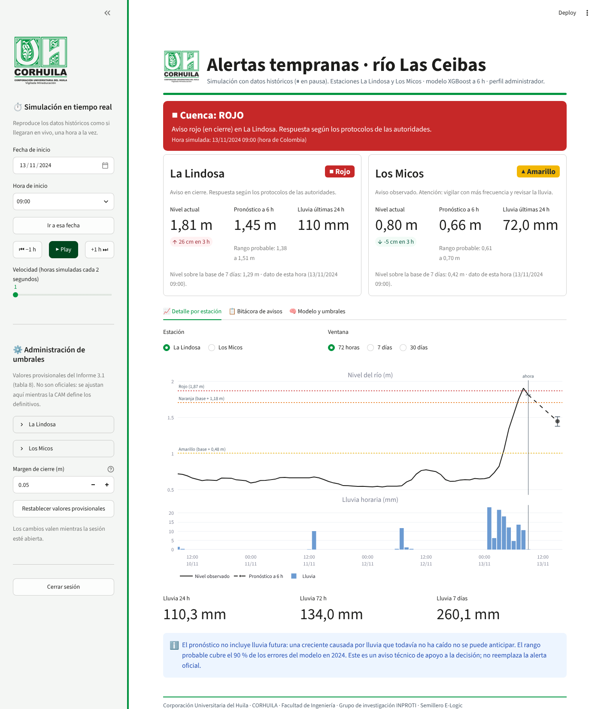

# dashboard · Alertas tempranas del río Las Ceibas (Actividad 3.2)

Tablero web hecho con **Streamlit** que integra el modelo predictivo (**XGBoost a 6 horas**) y muestra
**avisos en tiempo real** para las estaciones **La Lindosa** y **Los Micos**.



## Qué hace

- **Panel general:** una franja de color dice el peor estado de la cuenca. Debajo hay una tarjeta por
  estación con el nivel actual, cuánto subió o bajó en 3 horas, el pronóstico a 6 horas con su rango
  probable y la lluvia de las últimas 24 horas.
- **Detalle por estación:** gráfica del nivel (con los umbrales como líneas de color y el pronóstico
  punteado) y de la lluvia horaria, en ventanas de 72 horas, 7 días o 30 días.
- **Bitácora de avisos:** lista de los avisos (y de las fallas de datos) de los últimos días.
- **Modelo y umbrales:** desempeño del modelo, niveles de aviso y reglas de activación.
- **Administración** (barra lateral): cambiar los umbrales y controlar la simulación.

Usa los **colores institucionales de CORHUILA** (verde, blanco y negro) y su logo. El verde de la marca
va en líneas, botones y controles; los bloques de color llenos se reservan para los avisos, que además
siempre llevan ícono y palabra (● Normal, ▲ Amarillo...), para no confundir la marca con un estado.

Tiene **un solo perfil, el de administrador**, protegido con contraseña. No envía notificaciones
(correo, Telegram, etc.): los avisos se ven solo en el tablero.

### Niveles de aviso

| Estado | Cuándo | Acción sugerida |
|---|---|---|
| ● Normal (verde) | Nivel observado y pronosticado por debajo del umbral amarillo | Seguimiento rutinario |
| ▲ Amarillo | Nivel por encima de lo habitual | Vigilar con más frecuencia y revisar la lluvia |
| ▲ Naranja | Creciente importante en curso o esperada | Preparar recursos y la bocatoma |
| ■ Rojo | Nivel en el que se esperan afectaciones | Respuesta según los protocolos |
| ○ Sin dato (gris) | Más de 2 horas sin un nivel válido | Revisar la estación; no suponer que está normal |

Un aviso se activa si lo alcanza el **nivel observado** o el **pronóstico a 6 horas**. Sube de inmediato
y baja un nivel solo cuando todo queda por debajo de (umbral − 5 cm) durante 3 horas seguidas, para que no
se encienda y apague a cada rato. Es la lógica de la sección 7.3 del Informe 3.1.

**Umbrales provisionales** (Informe 3.1, tabla 8; **no son oficiales**):

| Estación | Amarillo | Naranja | Rojo |
|---|---|---|---|
| La Lindosa | 0,48 m sobre la base | 1,18 m sobre la base | 1,87 m de nivel |
| Los Micos | 0,37 m sobre la base | 0,68 m sobre la base | 1,03 m de nivel |

La **base** es el nivel mínimo de los últimos 7 días; medir sobre la base evita que los cambios de
referencia de los sensores desajusten los avisos. El Informe 3.1 deja el umbral rojo "por definir con la
CAM"; mientras tanto se usa el percentil 99,9 del nivel (solo para pruebas). Los umbrales se pueden
cambiar desde la barra lateral; para cambiarlos de forma permanente se edita `UMBRALES_PROVISIONALES`
en [`motor.py`](motor.py).

### ¿Cómo es "en tiempo real" si no hay conexión con las estaciones?

Todavía no hay un servicio que envíe los datos de las estaciones en vivo. Por eso el tablero **simula el
tiempo real** reproduciendo la serie histórica limpia (`data/clean`) hora por hora, como si los datos
fueran llegando. Con **▶ Play** avanza solo (cada 2 segundos avanza 1, 2, 3, 6, 12 o 24 horas
simuladas, según la velocidad elegida). También se puede ir a cualquier fecha entre 2017 y 2025.

Empieza el 13 de noviembre de 2024 a las 00:00, justo antes de unas crecientes que activan avisos
amarillo, naranja y rojo.

En cada hora el modelo solo usa datos de esa hora hacia atrás, igual que en operación real. Cuando exista
la conexión en vivo, solo hay que cambiar la función `cargar_serie` de `motor.py` para leer los datos
nuevos; el resto del tablero queda igual.

## Cómo ejecutarlo en su computador (paso a paso)

**1. Instalar Python.** Se necesita Python 3.10 o más reciente
([descarga](https://www.python.org/downloads/)). En Windows, marque la casilla
*"Add Python to PATH"* al instalar.

**2. Abrir una terminal en la carpeta del repositorio.** Es la carpeta `proyecto_cam_definitivo`
(la que tiene `data`, `dashboard`, `models`...).
- Windows: abra la carpeta en el Explorador, escriba `cmd` en la barra de direcciones y presione Enter.
- Mac o Linux: abra la Terminal y escriba `cd ` seguido de la ruta de la carpeta.

**3. Instalar las librerías** (solo la primera vez):

```
python -m pip install -r dashboard/requirements.txt
```

**4. Abrir el tablero:**

```
python -m streamlit run dashboard/app.py
```

Use `python -m streamlit` y no solo `streamlit`: así funciona también en Windows, donde a veces
aparece el error *"streamlit no se reconoce como un comando"*. Si `python` tampoco se reconoce,
pruebe con `py -m streamlit run dashboard/app.py`.

Se abre solo en el navegador (si no, entre a <http://localhost:8501>).

**5. Entrar.** La contraseña por defecto es **`admin`**. Para cambiarla, copie el archivo
`.streamlit/secrets.toml.ejemplo` como `.streamlit/secrets.toml` y escriba la nueva clave en
`ADMIN_PASSWORD`. Ese archivo no se sube a GitHub.

Para cerrar el tablero, vuelva a la terminal y presione `Ctrl + C`.

## Cómo publicarlo en internet (Streamlit Community Cloud, gratis)

1. Entrar a <https://share.streamlit.io> con la cuenta de GitHub que tiene acceso al repositorio.
2. Clic en **Create app** → **Deploy a public app from GitHub**.
3. Elegir el repositorio, la rama `main` y en **Main file path** escribir `dashboard/app.py`.
4. En **Advanced settings → Secrets** escribir la contraseña del administrador:
   ```
   ADMIN_PASSWORD = "una-clave-segura"
   ```
   **Importante:** sin este paso la clave queda como `admin`.
5. Clic en **Deploy**. La primera vez tarda unos minutos mientras instala las librerías.

Community Cloud usa el `dashboard/requirements.txt` y el tema de `.streamlit/config.toml`; no hay que
configurar nada más. Si el repositorio es privado, la aplicación también se puede dejar privada desde
la configuración de la app (*Sharing*).

## Archivos

| Archivo | Qué es |
|---|---|
| [`app.py`](app.py) | La interfaz del tablero (Streamlit). |
| [`motor.py`](motor.py) | Datos, modelo y lógica de avisos, sin nada de interfaz. Aquí están los umbrales. |
| [`entrenar_modelos.py`](entrenar_modelos.py) | Vuelve a entrenar y guardar los modelos. |
| `modelos/` | Modelos XGBoost entrenados (`.json`) y sus datos de apoyo (`_info.json`). |
| [`requirements.txt`](requirements.txt) | Librerías necesarias. |
| `assets/logo_corhuila.png` | Logo de CORHUILA. |
| `../.streamlit/config.toml` | Colores del tablero (verde, blanco y negro de CORHUILA). |
| `../.streamlit/secrets.toml.ejemplo` | Ejemplo para poner la contraseña. |

## El modelo

Es el mismo XGBoost de los notebooks [`05_modelos_La_Lindosa`](../notebooks/05_modelos_La_Lindosa.ipynb) y
[`06_modelos_Los_Micos`](../notebooks/06_modelos_Los_Micos.ipynb) (ver [`models/README.md`](../models/README.md)):
mismos atributos, mismos hiperparámetros y misma partición (entrena con 2018-2023, se ajusta con 2024).
Predice el cambio de nivel en las próximas 6 horas. El modelo guardado da un error típico (RMSE) en 2025
de 6,2 cm en La Lindosa y 3,7 cm en Los Micos, igual a lo reportado en la Actividad 2.

El **rango probable** que se muestra junto al pronóstico cubre el 90 % de los errores del modelo en 2024.
El pronóstico **no incluye lluvia futura**: una creciente causada por lluvia que todavía no ha caído no
se puede anticipar.

Si cambian los datos limpios, se vuelve a entrenar con (tarda unos segundos):

```
python dashboard/entrenar_modelos.py
```

Si el tablero no encuentra los modelos, o no dan el resultado esperado (por ejemplo, con otra versión de
XGBoost), los entrena solo al arrancar.

## Limitaciones

- Los umbrales son **provisionales**; los oficiales los define la CAM con la OGRD y Las Ceibas E.S.P.
- El "tiempo real" es una **simulación** con datos históricos.
- Los cambios de umbrales hechos desde la barra lateral duran mientras la sesión esté abierta.
- Es un aviso técnico de apoyo a la decisión; **no reemplaza la alerta oficial**.
