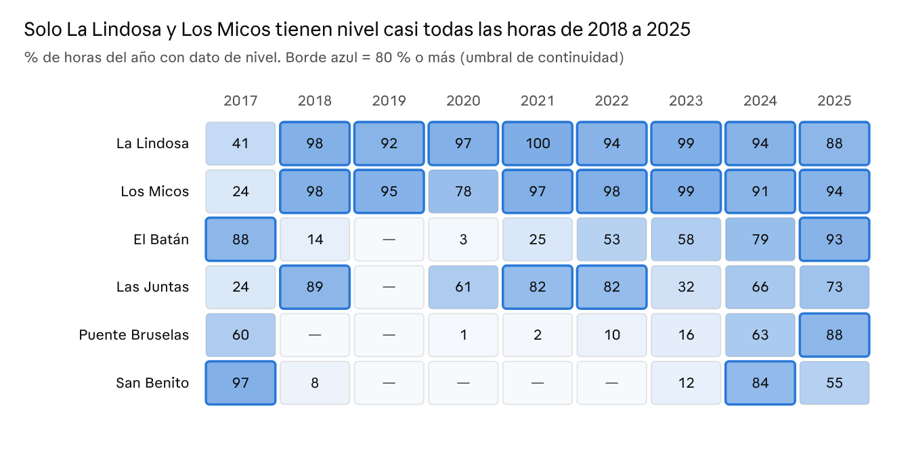

# Estaciones con nivel del río y aptitud para predicción

25 de noviembre de 2026 · 

Seis de las nueve estaciones miden nivel del río, pero solo **La Lindosa y Los Micos** tienen series lo bastante largas y continuas para empezar a entrenar modelos de predicción ya: unos 8 años (2018-2025) con más del 90 % de las horas con dato y tramos sin cortes de más de 15 meses.

**El Batán y Las Juntas** sirven como segunda prioridad, con periodos recortados y relleno de huecos. **Puente Bruselas y San Benito** no son aptas por ahora: tienen años enteros sin datos y, en San Benito, un cambio de referencia del sensor que impide comparar 2017-2018 con 2023-2025.

El análisis usa los archivos consolidados de `data/processed/` (datos hasta el 31/12/2025), llevados a resolución horaria.

## Qué estaciones miden nivel

| Estación | Mide nivel | Otras variables útiles como predictores | Periodo con nivel |
| --- | --- | --- | --- |
| La Lindosa | Sí | Lluvia, temperatura | jun 2017 – dic 2025 |
| Los Micos | Sí | Lluvia, temperatura | oct 2017 – dic 2025 |
| El Batán | Sí | Lluvia, temperatura, humedad, radiación, viento | ene 2017 – dic 2025 (sin 2019) |
| Las Juntas | Sí | Lluvia | oct 2017 – dic 2025 (sin 2019) |
| Puente Bruselas | Sí | Lluvia, velocidad del agua | ene 2017 – dic 2025 (sin 2018-2019) |
| San Benito | Sí | Lluvia, velocidad del agua | ene 2017 – dic 2025 (sin 2019-2022) |
| El Mesón | No | Estación meteorológica | — |
| San Bartolo | No | Estación meteorológica | — |
| Santa Rosalía | No | Estación meteorológica | — |

Las tres estaciones meteorológicas no se pueden predecir como nivel, pero su lluvia puede servir como variable de entrada para las estaciones de nivel de la misma cuenca. Falta confirmar qué estaciones comparten cuenca.

## Criterios de evaluación

Una estación es apta para predicción de series de tiempo cuando cumple estos cuatro criterios:

1. **Longitud:** al menos 3 años con dato, para que el modelo vea varias temporadas de lluvias y de estiaje.
2. **Continuidad:** más del 80 % de las horas con dato por año y tramos sin cortes (huecos de máx. 6 h) de varios meses. Los modelos como LSTM o ARIMA necesitan ventanas seguidas.
3. **Consistencia:** el nivel debe medirse siempre con la misma referencia. Un salto de nivel por cambio de sensor hace que el modelo aprenda un patrón falso.
4. **Predictores:** lluvia en la misma estación (o cercana) con buena cobertura, porque es la principal causa de las crecidas.

## Diagnóstico por estación

*Fuente: `data/processed/<estación>/<estación>_consolidado.csv`, nivel promediado por hora. 2017 incluye los meses antes de que arrancara cada estación.*

- **La Lindosa:** desde 2018 nunca baja del 88 % de horas con dato. Nivel estable (mediana 0,6-0,9 m) con crecidas de hasta 3,7 m, justo lo que un modelo debe aprender.
- **Los Micos:** igual de completa, con el tramo continuo más largo de todas (494 días). La mediana baja de ~0,45 m a ~0,2 m en 2021-2022 y luego sube; puede ser un cambio real del río o del sensor.
- **El Batán:** completa en 2017 y desde 2024, pero con 2018-2022 casi vacíos. Es la que tiene más variables meteorológicas propias.
- **Las Juntas:** cobertura irregular (32-89 %) y la mediana cambia mucho entre años (0,19 m en 2025 frente a 0,71 m en 2023).
- **Puente Bruselas:** solo 2024-2025 tienen datos útiles y ningún tramo continuo supera 55 días.
- **San Benito:** 2017 está completo pero con valores de 0 a 7,8 m y 741 saltos de más de 0,5 m en una hora, señal de ruido. No hay nivel de 2019 a 2022.

## Clasificación y periodo recomendado

| Prioridad | Estación | Aptitud | Periodo recomendado para entrenar | Tramo continuo más largo | Condición antes de usar |
| --- | --- | --- | --- | --- | --- |
| 1 | Los Micos | Apta | 2018 – 2025 | 494 días (jun 2024 – oct 2025) | Revisar la bajada de nivel de 2021-2022 |
| 1 | La Lindosa | Apta | 2018 – 2025 | 460 días (sep 2022 – dic 2023) | Ninguna |
| 2 | El Batán | Apta con limitaciones | 2023 – 2025 | 222 días (ene – ago 2025) | Usar solo desde 2023; lluvia vacía en 2020-2022 |
| 3 | Las Juntas | Apta con limitaciones | 2020 – 2025 | 156 días (jun – nov 2025) | Rellenar huecos y revisar saltos de nivel entre años |
| — | Puente Bruselas | No apta por ahora | 2025 (solo para pruebas) | 55 días | Esperar más datos; la lluvia falta en el 35 % de 2025 |
| — | San Benito | No apta por ahora | 2024 – 2025 (solo para pruebas) | 250 días (jun 2024 – feb 2025) | Cambio de referencia del sensor; no mezclar con 2017-2018 |

Con las dos estaciones de prioridad 1 se puede montar y validar el primer modelo. Las de prioridad 2 y 3 sirven después para probar si el modelo se generaliza a otros ríos.

## Próximos pasos

- [x] Llevar La Lindosa y Los Micos a resolución horaria (nivel promedio, lluvia sumada), porque 2017-2019 es horario y 2020-2025 es cada 5 min.
- [x] Rellenar huecos cortos por interpolación y marcar los largos para excluirlos de las ventanas de entrenamiento (La Lindosa y Los Micos, ver [`data/clean/`](../data/clean/README.md)).
- [ ] Confirmar con el operador si hubo cambio de sensor o de referencia en Los Micos (2021-2022), Las Juntas y San Benito.
- [x] Aplicar a 2017-2019 el filtro de "sensor pegado" del PDF de observaciones (hecho para La Lindosa y Los Micos; falta en las demás estaciones).
- [ ] Definir el horizonte de predicción (por ejemplo 6, 12 o 24 h) y separar 2025 como año de prueba.
- [ ] Identificar qué estaciones meteorológicas están aguas arriba de cada estación de nivel, para usar su lluvia como predictor.
